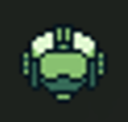

  

**Licencia:** [Apache 2.0](LICENSE)

# Star Explorer

**Juegos en Red · Grado en Diseño y Desarrollo de Videojuegos · URJC · Curso 2026/27** 
**Grupo A: Star Studios**

## Descripción de la temática

Star Explorer es un juego de lucha y plataformas en 2D para dos jugadores en red en el que los jugadores compiten por el control de un sistema estelar en una guerra espacial\[cite: 8, 9]. Ambientado en diferentes planetas con escenarios cíclicos en 2D y una cámara con desplazamiento continuo\[cite: 9, 10, 11], los jugadores deben utilizar diversas armas y habilidades tácticas (láser teledirigido, bombas, escudos, balas corrosivas y láser continuo) para eliminar a sus rivales y ser el último en pie.

\---

## Game Design Document

El documento de diseño completo está en [**GDD.md**](GDD.md).

Apartados principales:

* [Especificaciones básicas](GDD.md#2-especificaciones-básicas)
* [Jugabilidad](GDD.md#3-jugabilidad)
* [Narrativa](GDD.md#4-narrativa)
* [Imagen y diseño visual](GDD.md#5-imagen-y-diseño-visual)
* [Sonido](GDD.md#6-sonido)
* [Aspectos técnicos y migración (Unity a Phaser 4)](#7-aspectos-técnicos-y-migración-unity-a-phaser-4)
* [Interfaz y diagrama de flujo](GDD.md#7-interfaz-y-diagrama-de-flujo)

\---

## Fases del proyecto

|Fase|Contenido|Estado|
|-|-|-|
|Fase 1|Equipo, temática y GDD|Entregada|
|Fase 2|Juego en local|Pendiente|
|Fase 3|API REST|Pendiente|
|Fase 4|WebSockets|Pendiente|

